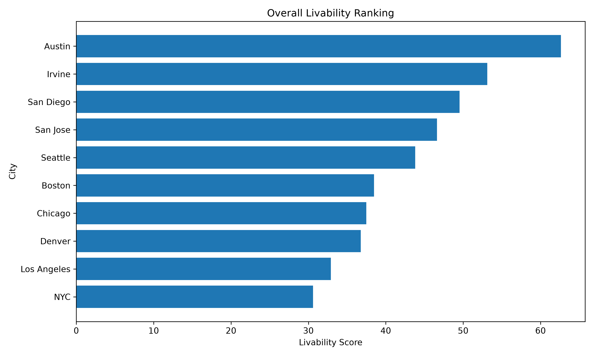

# U.S. City Livability Analysis

## Overview

This project compares the livability of 10 major U.S. cities using eight factors: safety, income, cost of living, weather, job opportunities, transportation, healthcare, and entertainment.

I originally created this analysis using Google Sheets and later rebuilt it in Python to practice data analysis and programming. The Python version reads the raw city data, normalizes metrics with different scales, applies weights to each category, calculates an overall livability score, and ranks the cities.

## Methodology

Because the eight metrics use different units and scales, I normalized each metric to a score from 0 to 100 before combining them.

Three normalization methods are used:

- **Higher is better:** Used for metrics such as income, walkability, healthcare availability, and entertainment.
- **Lower is better:** Used for crime rate, rent, and unemployment.
- **Ideal value:** Used for weather. Instead of assuming that a higher or lower temperature is always better, the model scores temperatures based on their distance from an ideal temperature of 72°F.

After normalization, each category is assigned a weight based on its importance in the model:

| Category | Weight |
|---|---:|
| Safety | 20% |
| Income | 15% |
| Cost of Living | 20% |
| Weather | 10% |
| Job Opportunities | 15% |
| Transportation | 8% |
| Healthcare | 7% |
| Entertainment | 5% |

The weights add up to 100%. The final livability score is calculated by multiplying each normalized category score by its weight and adding the weighted scores together.

## Results

The model ranked the cities in the following order:

| Rank | City | Livability Score |
|---:|---|---:|
| 1 | Austin | 62.63 |
| 2 | Irvine | 53.13 |
| 3 | San Diego | 49.52 |
| 4 | San Jose | 46.62 |
| 5 | Seattle | 43.81 |
| 6 | Boston | 38.49 |
| 7 | Chicago | 37.48 |
| 8 | Denver | 36.77 |
| 9 | Los Angeles | 32.90 |
| 10 | New York City | 30.59 |



The results reflect the priorities represented by the selected weights and should not be interpreted as an objective ranking of which city is universally "best."

## Technologies

- Python
- pandas
- Matplotlib

## Project Structure

```text
city-livability-analysis/
├── data/
│   └── city_data.csv
├── output/
│   ├── city_rankings.csv
│   └── city_rankings.png
├── analysis.py
└── README.md
```

## How to Run

Install the required Python libraries:

```bash
pip install pandas matplotlib
```

Run the analysis:

```bash
python analysis.py
```

The script calculates the normalized and weighted scores, ranks the cities, saves the final rankings as a CSV file, and generates a visualization of the results.

## Data Sources

The dataset was compiled for the original version of this project using publicly available government statistics and third-party city-level data. The Python version analyzes the compiled dataset rather than retrieving live data from these sources.

Sources consulted include:

- **Safety:** FBI Crime Data Explorer
- **Income and Population:** U.S. Census Bureau / American Community Survey
- **Cost of Living:** Numbeo
- **Employment:** U.S. Bureau of Labor Statistics and FRED
- **Weather and Environment:** National Weather Service, AirNow, and U.S. Environmental Protection Agency
- **Transportation:** Walk Score, U.S. Department of Transportation, National Transit Database, Bureau of Transportation Statistics, and U.S. Census Bureau
- **Healthcare:** U.S. Department of Health & Human Services, Centers for Medicare & Medicaid Services, American Hospital Association, U.S. Census Bureau, and CityHealth
- **Entertainment and Recreation:** Google Maps Platform, Yelp Fusion API, U.S. Bureau of Economic Analysis, National Center for Charitable Statistics, and WalletHub

### Selected Links

- FBI Crime Data Explorer: https://cde.ucr.cjis.gov
- U.S. Census Bureau: https://data.census.gov
- Numbeo: https://www.numbeo.com/cost-of-living/
- U.S. Bureau of Labor Statistics: https://data.bls.gov
- BLS Local Area Unemployment Statistics: https://www.bls.gov/lau/
- FRED: https://fred.stlouisfed.org
- National Weather Service: https://www.weather.gov
- AirNow: https://www.airnow.gov
- EPA Outdoor Air Quality Data: https://www.epa.gov/outdoor-air-quality-data
- Bureau of Transportation Statistics: https://www.bts.gov

## Limitations

This project has several limitations:

- The category weights are subjective and represent one possible set of priorities.
- Only 10 U.S. cities are included.
- Data from different sources may have been collected during different time periods.
- City-level indicators cannot capture every factor that affects an individual's quality of life.
- Changing the weights or normalization assumptions can change the rankings.

## Future Improvements

Possible improvements include:

- Allowing users to choose their own category weights
- Expanding the dataset to include more cities
- Automating data collection from public APIs
- Adding additional visualizations
- Comparing how rankings change under different weighting preferences
